# Horizon TechX – Network Toolkit

A Python-based network diagnostics, packet sniffing, and traffic analysis toolkit built using **Scapy** and **Tkinter**. It provides CLI and GUI interfaces for network troubleshooting, packet inspection, DNS resolution, and traffic analytics.

Developed as part of the **Horizon TechX Cybersecurity Internship**.

## 🚀 Features

- **Network Sniffer:** Capture and inspect network packets.
- **Ping Test:** Check host reachability and response time.
- **DNS Lookup:** Resolve domain names and retrieve IP addresses.
- **Network Information:** Display hostname, IP address, platform, and architecture.
- **Traceroute:** Trace the network path to a destination.
- **Traffic Analytics:** Analyze captured packets, protocols, packet sizes, and source/destination IPs.
- **Report Generation:** Export traffic analytics in TXT and CSV formats.
- **Dual Interface:** Access features through CLI and Tkinter GUI.

## 🛠️ Technologies

| Technology | Purpose |
|---|---|
| Python | Core development |
| Scapy | Packet capture and analysis |
| Tkinter | Graphical interface |
| Socket | Network operations |
| CSV | Report export |

## 📁 Project Structure

```text
HorizonTechX-Network-Toolkit/
│
├── src/
│   ├── analytics.py
│   ├── cli.py
│   ├── diagnostics.py
│   ├── dns_lookup.py
│   ├── gui.py
│   ├── main.py
│   ├── reporter.py
│   └── sniffer.py
│
├── reports/
│   ├── traffic_analytics_20261103_134739.txt
│   └── traffic_analytics_20261103_134739.csv
│
├── screenshots/
│   ├── 1.png
│   ├── 2.png
│   ├── ...
│   └── 14.png
│
├── .gitignore
├── README.md
└── requirements.txt
```

## ⚙️ Installation

### 1. Clone the Repository

```bash
git clone https://github.com/mrhackoi/HorizonTechX-Network-Toolkit.git
cd HorizonTechX-Network-Toolkit
```

### 2. Create a Virtual Environment

```bash
python3 -m venv venv
source venv/bin/activate
```

### 3. Install Dependencies

```bash
python -m pip install --upgrade pip
pip install -r requirements.txt
```

### 4. Verify the Source Code

```bash
python -m compileall -q src
```

## ▶️ Usage

### CLI Mode

```bash
python src/main.py
```

Select **CLI Mode** from the application menu.

Available options:

1. Network Sniffer
2. Ping Test
3. DNS Lookup
4. Network Information
5. Traceroute
6. Traffic Analytics
7. Exit

### GUI Mode

```bash
python src/gui.py
```

## 🔐 Root / Sudo Permissions

On Kali Linux and other Linux systems, packet capture requires appropriate permissions to access network interfaces.

For packet-capture functionality, launch the application with elevated privileges.

**CLI with root permissions:**

```bash
sudo ./venv/bin/python src/main.py
```

**GUI with root permissions:**

```bash
sudo ./venv/bin/python src/gui.py
```

| Feature | Permission |
|---|---|
| Network Sniffer | Elevated permissions required for packet capture |
| Traffic Analytics | Elevated permissions required for packet capture |
| Ping Test | Generally no root required |
| DNS Lookup | No root required |
| Network Information | No root required |
| Traceroute | Depends on system and method |

**Important:** You do not need to run every diagnostic operation as root. Use elevated privileges when packet-capture functionality requires them. Only capture traffic on networks you own or are authorized to inspect.

## 📊 Testing & Verification

Tested in a Kali Linux environment.

**Environment**

- OS: Kali Linux Rolling 2026.3
- Python: 3.14.7
- Scapy: 2.8.0
- Architecture: x86_64

| Test | Result |
|---|---|
| Python compilation | Passed |
| Application launcher | Passed |
| CLI launch | Passed |
| Ping – 127.0.0.1 | 4 received, 0% packet loss |
| DNS – google.com | Successfully resolved |
| Network Information | Passed |
| Traceroute – google.com | Destination reached at hop 9 |
| Traffic Analytics | Successfully captured packets |
| TXT Report Export | Generated |
| CSV Report Export | Generated |
| Network Sniffer | 20 packets captured on eth0 |
| GUI Launch | Successfully launched |

An initial sniffer run captured zero packets. A subsequent run successfully captured 20 packets.

## 📄 Generated Reports

Traffic Analytics supports two export formats:

- **TXT:** Human-readable traffic summary.
- **CSV:** Structured data for further analysis.

Generated reports are stored in the `reports/` directory.

## 📸 Screenshots & Demonstration

The following screenshots document the setup, installation, CLI operations, network diagnostics, packet capture, analytics, and GUI.

### 1. Environment Setup
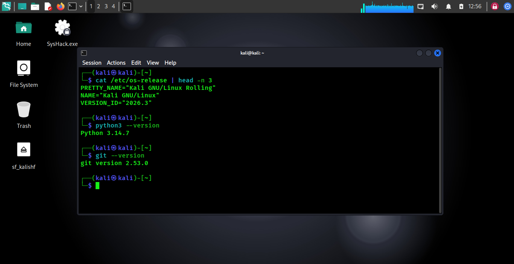

### 2. Repository Setup
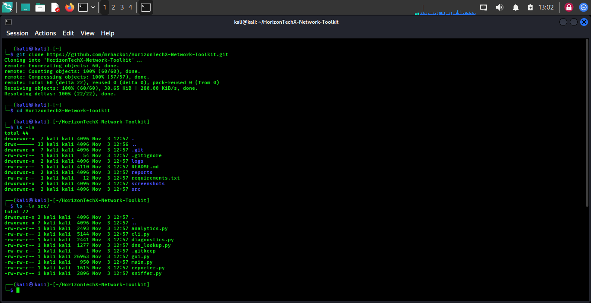

### 3. Virtual Environment
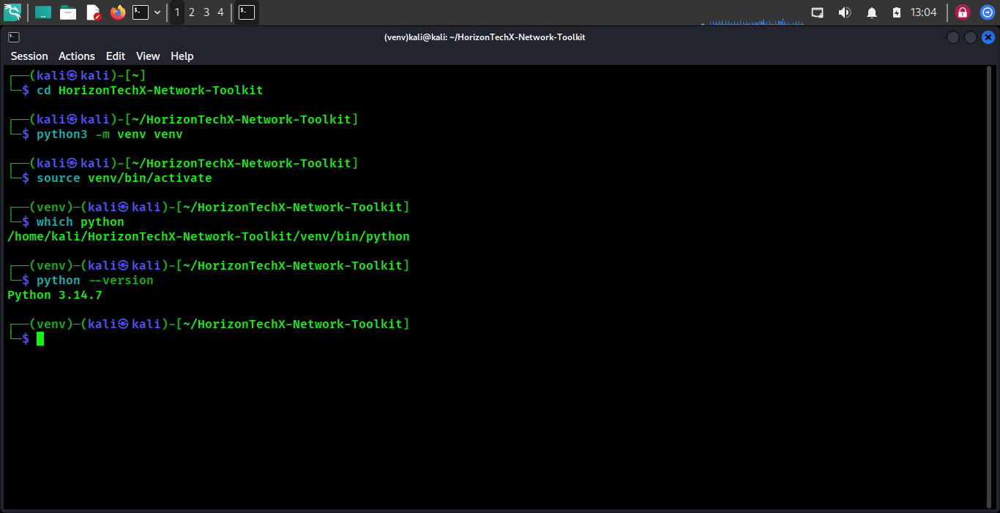

### 4. Dependency Installation
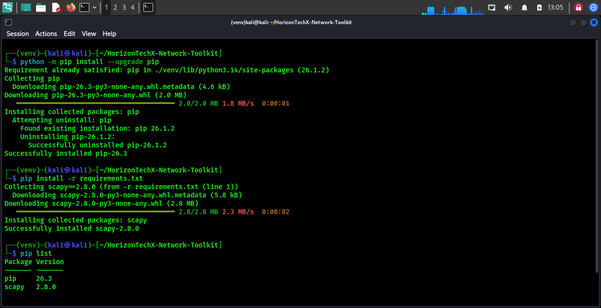

### 5. Source Compilation
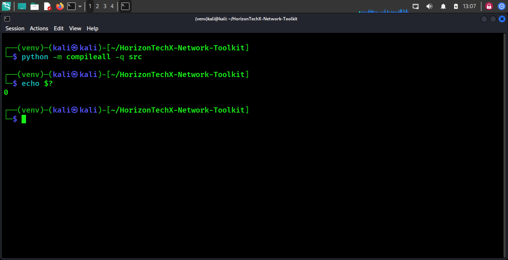

### 6. Application Launcher
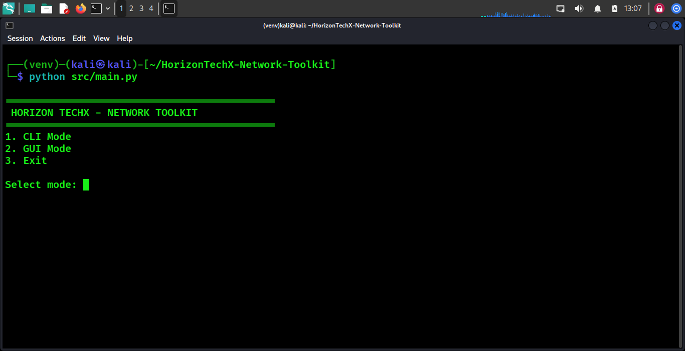

### 7. CLI Interface
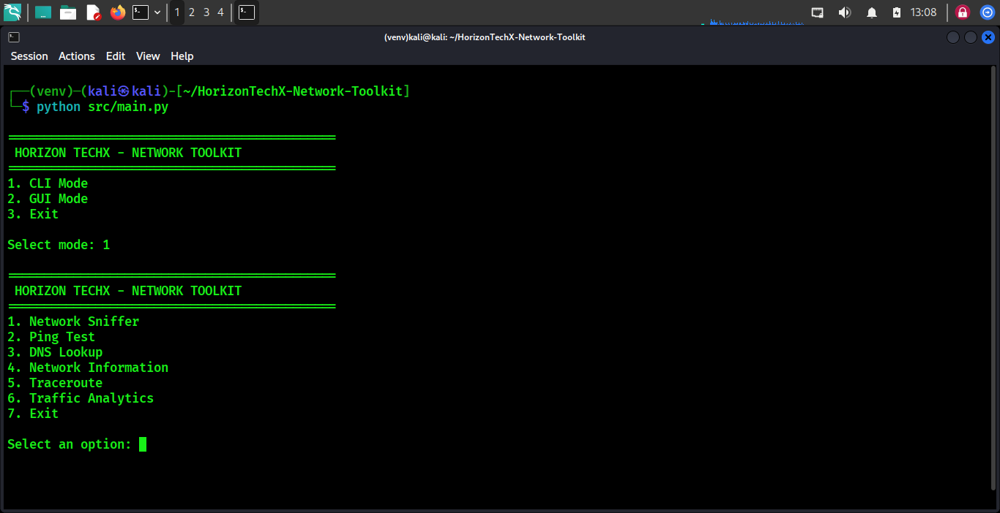

### 8. Ping Test
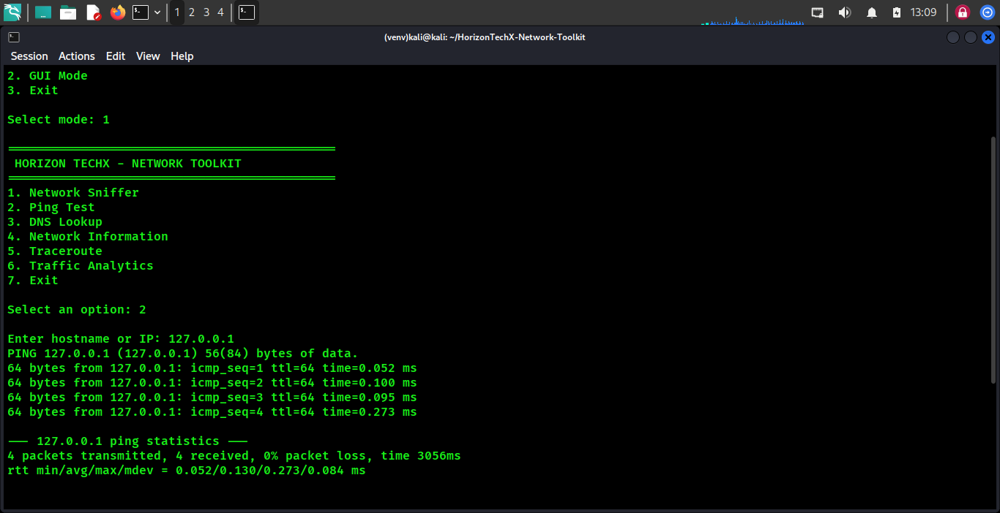

### 9. DNS Lookup
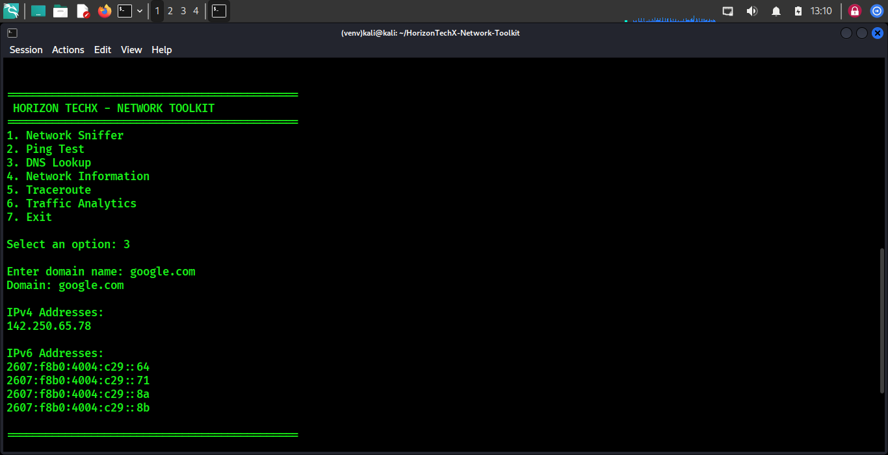

### 10. Network Information
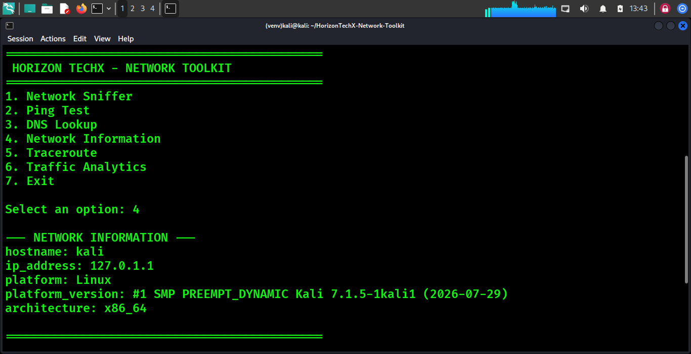

### 11. Traceroute
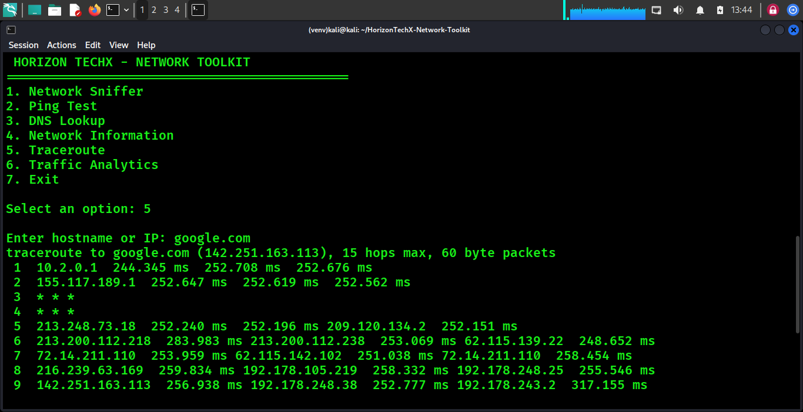

### 12. Traffic Analytics & Reports
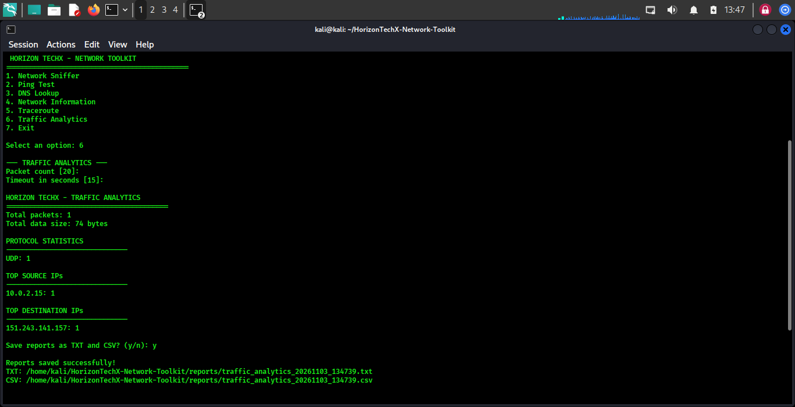

### 13. Network Sniffer
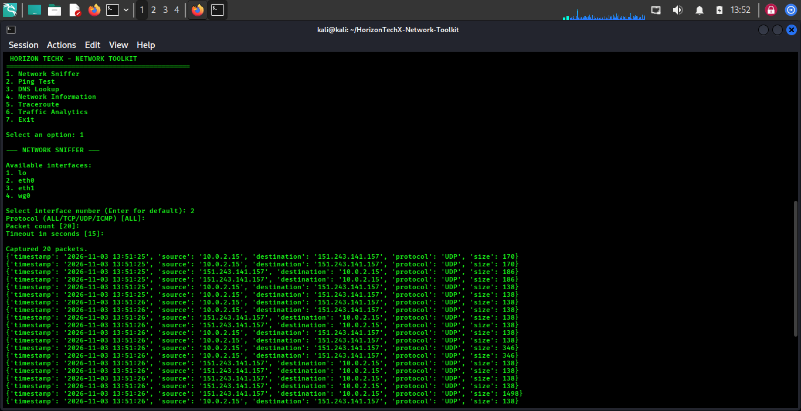

### 14. GUI Dashboard
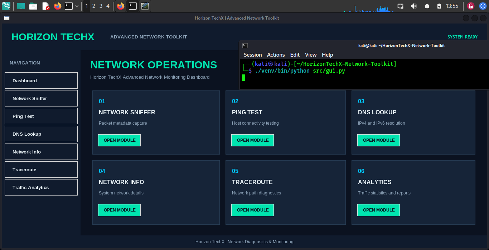

## ⚠️ Limitations

- Packet capture depends on interface permissions and available network traffic.
- Virtual machine network configurations may affect captured traffic.
- Traceroute results vary with routing and firewall configurations.
- GUI operation requires a supported graphical desktop environment.
- Packet capture should only be performed in authorized environments.

## 🔮 Future Improvements

- Real-time traffic visualization.
- Advanced protocol filtering.
- Improved packet statistics.
- Enhanced reporting capabilities.
- Additional GUI dashboard features.

## 👨‍💻 Author

**Dhoni Kumar Shah**

Cybersecurity | Network Security | VAPT | Security Research

GitHub: [@mrhackoi](https://github.com/mrhackoi)

## 📜 Disclaimer

This project is intended for educational purposes, authorized network diagnostics, and defensive security testing only. The developer is not responsible for unauthorized use.

---

**Horizon TechX – Network Toolkit**

*Learn • Analyze • Secure*
